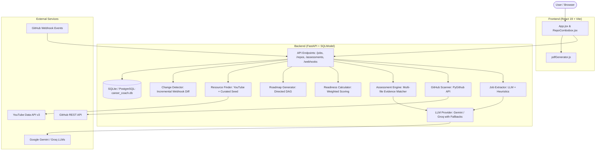

# AI Career Coach & Skill Gap Analyzer

A full-stack, production-ready AI platform that analyzes engineering job descriptions, scans GitHub repositories for verifiable technical evidence, evaluates candidate readiness, detects incremental repository changes via GitHub webhooks, and synthesizes interactive learning roadmaps with curated resources.

---

## 📑 Table of Contents

1. [System Overview & Architecture](#-system-overview--architecture)
2. [Project Directory Structure](#-project-directory-structure)
3. [Core Capabilities & Workflow](#-core-capabilities--workflow)
4. [Technology Stack](#-technology-stack)
5. [Installation & Setup](#-installation--setup)
6. [Complete Codebase Architecture & File Explanations](#-complete-codebase-architecture--file-explanations)
   - [Backend Core & Configuration](#1-backend-core--configuration)
   - [Database Models & Schemas](#2-database-models--schemas)
   - [API Endpoints & Routers](#3-api-endpoints--routers)
   - [AI & Analysis Services](#4-ai--analysis-services)
   - [Backend Verification Suites](#5-backend-verification-suites)
   - [Frontend Architecture & UI Components](#6-frontend-architecture--ui-components)
   - [Frontend Utilities & Testing](#7-frontend-utilities--testing)
7. [Comprehensive Deep-Dive Documentation Index](#-comprehensive-deep-dive-documentation-index)

---

## 🏛 System Overview & Architecture

The AI Career Coach addresses the discrepancy between job qualifications and real candidate capability by providing **evidence-based skill assessment**:



---

## 📂 Project Directory Structure

```text
kurukshetra-main/
│
├── backend/                               # FastAPI Application
│   ├── app/
│   │   ├── api/                           # HTTP REST API Endpoints
│   │   │   ├── assessments.py             # Assessment execution & results
│   │   │   ├── health.py                  # Liveness, readiness & system status
│   │   │   ├── jobs.py                    # Job parsing, extraction & retrieval
│   │   │   ├── repos.py                   # GitHub repo linking & tree listing
│   │   │   └── webhooks.py                # GitHub push event webhook & HMAC check
│   │   ├── core/                          # Infrastructure & Settings
│   │   │   ├── config.py                  # Pydantic Settings & environment loader
│   │   │   ├── db.py                      # SQLModel engine & auto-migration
│   │   │   └── repo_parser.py             # URL/SSH parsing for GitHub references
│   │   ├── models/                        # Database Entities
│   │   │   └── entities.py                # Job, Requirement, Assessment, Citation, etc.
│   │   ├── schemas/                       # Pydantic Request/Response DTOs
│   │   │   ├── assessment.py              # Assessment input/output models
│   │   │   ├── job.py                     # Job ingestion & parsing schemas
│   │   │   └── repo.py                    # Repository linkage schemas
│   │   ├── services/                      # Domain & Business Logic
│   │   │   ├── assessment_engine.py       # Candidate evidence evaluation engine
│   │   │   ├── change_detector.py         # Incremental diff evaluator on git push
│   │   │   ├── gemini_service.py          # Google Gemini integration client
│   │   │   ├── github_scanner.py          # GitHub tree retrieval & regex scanner
│   │   │   ├── job_extractor.py           # Job text to structured requirement specs
│   │   │   ├── job_fetcher.py             # Web scraper / fetcher for job URLs
│   │   │   ├── llm_provider.py            # Unified LLM provider (Gemini + Groq)
│   │   │   ├── readiness_calculator.py    # Weighted 0-100 score computation
│   │   │   ├── resource_finder.py         # YouTube and seed learning resources
│   │   │   └── roadmap_generator.py       # DAG skill milestone generator
│   │   ├── main.py                        # FastAPI entry point & CORS configuration
│   │   └── resources_seed.json            # Curated learning materials catalog
│   ├── verify_level1.py                   # Verification suite: DB & Models
│   ├── verify_level2.py                   # Verification suite: Job parsing & scanner
│   ├── verify_level3.py                   # Verification suite: Assessment engine
│   ├── verify_level4.py                   # Verification suite: Webhooks & change detection
│   ├── verify_level5.py                   # Verification suite: Roadmap & resources
│   └── verify_llm.py                      # LLM connectivity & fallback verification
│
├── frontend/                              # React 19 Client SPA
│   ├── src/
│   │   ├── components/
│   │   │   └── RepoCombobox.jsx           # Autocomplete combobox for repositories
│   │   ├── data/
│   │   │   ├── demoData.js                # Pre-configured demo jobs & evaluation fixtures
│   │   │   └── demoData.test.js           # Structural unit tests for demo fixtures
│   │   ├── utils/
│   │   │   ├── parseGithubRepo.js         # Client-side GitHub URL/SSH parser
│   │   │   ├── parseGithubRepo.test.js    # Comprehensive test suite for URL parsing
│   │   │   └── pdfGenerator.js            # Client-side multi-page PDF report builder
│   │   ├── App.jsx                        # Root React component & state machine
│   │   ├── App.css                        # Main application styles & theme tokens
│   │   ├── index.css                      # Global Tailwind / CSS reset
│   │   └── main.jsx                       # React DOM entry point
│   ├── package.json                       # Frontend dependencies & npm scripts
│   └── vite.config.js                     # Vite build configuration & server port
│
├── docs/                                  # In-Depth Line-by-Line Documentation
│   ├── 01_BACKEND_CORE.md                 # Main entry, database, settings & models
│   ├── 02_API_ROUTERS.md                  # REST controllers and routing logic
│   ├── 03_SERVICES_AND_LLM.md             # LLM orchestration, evaluation & roadmaps
│   ├── 04_VERIFICATION_SUITES.md          # Test automation & validation levels
│   └── 05_FRONTEND_CODEBASE.md            # React UI, PDF generator & client tests
│
├── ai_career_coach_architecture.md        # Comprehensive technical architecture
├── requirements.txt                       # Backend Python dependencies
└── README.md                              # This master documentation file
```

---

## ⚡ Core Capabilities & Workflow

1. **Job Ingestion & Parsing**:
   - Accepts raw text paste or URL scraping of job descriptions.
   - Extracts title, company, seniority level, domain, and structured requirements (categorized into `Languages`, `Frameworks`, `Databases`, `Architecture`, `Tools`, etc.) with weights (`required`, `preferred`, `bonus`).

2. **Repository Scanning**:
   - Inspects public or authenticated private GitHub repositories via PyGithub.
   - Parses tree blobs, extracting package manifests (`package.json`, `pom.xml`, `requirements.txt`, `go.mod`, `Cargo.toml`, `build.gradle`), configuration files, and source code.

3. **Deterministic & AI Evidence Assessment**:
   - Evaluates requirements using a hybrid pipeline:
     - **Heuristic matching**: Manifest dependency checks, code keyword frequency, file path recognition.
     - **LLM Reasoning**: Evaluates architectural depth, design patterns, testing practices, and returns verifiable line-numbered code citations.
   - Outputs status: `MET`, `PARTIAL`, `UNMET`, or `NEEDS_REVIEW` along with confidence scores (0.0 to 1.0).

4. **Weighted Readiness Score**:
   - Computes overall candidate readiness (0 to 100) using category-weighted and requirement-type-weighted algorithms:
     $$\text{Readiness} = \sum (\text{weight}_i \times \text{status\_multiplier}_i) \times 100$$

5. **Personalized Learning Roadmap**:
   - Constructs a sequence of learning milestones targeted at unmet and partial skills.
   - Organizes milestones into foundational, core, and advanced phases.

6. **Curated & Live Learning Resources**:
   - Queries YouTube Data API v3 for targeted video courses and tutorials.
   - Falls back gracefully to `resources_seed.json` with documentation, books, and courses.

7. **Incremental Webhook Monitoring**:
   - Receives GitHub `push` event webhooks verified with HMAC-SHA256 signatures.
   - Detects modified and newly added files and re-evaluates only affected requirements, updating audit history.

8. **PDF Report Export**:
   - Generates client-side multi-page PDF assessment reports complete with readiness scores, requirement breakdown tables, cited file paths, and customized learning roadmaps.

---

## 🛠 Technology Stack

### Backend
- **Framework**: FastAPI (Python 3.10+)
- **ORM / Persistence**: SQLModel (SQLAlchemy 2.0 under the hood) + SQLite / PostgreSQL
- **LLM Integrations**: Google Gemini (`google-genai`), Groq API (`groq`)
- **VCS & Scraper**: PyGithub, BeautifulSoup4, Requests, httpx
- **Security & Validation**: Pydantic v2, hashlib HMAC-SHA256

### Frontend
- **Framework**: React 19
- **Build Tool**: Vite 8
- **Icons**: Lucide React
- **Routing**: React Router DOM 7
- **Linter**: Oxlint
- **PDF Generation**: Native Canvas / Custom HTML-to-PDF engine (`pdfGenerator.js`)

---

## 🚀 Installation & Setup

### 1. Prerequisites
- Python 3.10 or higher
- Node.js 18 or higher & npm

### 2. Backend Setup
```bash
# Navigate to backend directory
cd backend

# Create and activate virtual environment (Windows PowerShell)
python -m venv venv
.\venv\Scripts\Activate.ps1

# Install Python dependencies
pip install -r ..\requirements.txt

# Run database initialization and test suites
python verify_level1.py

# Start FastAPI development server
uvicorn app.main:app --reload --port 8000
```

### 3. Frontend Setup
```bash
# In another terminal, navigate to frontend
cd frontend

# Install Node dependencies
npm install

# Start Vite dev server
npm run dev
```

The frontend will be accessible at `http://localhost:5173` and the backend Swagger interactive documentation at `http://localhost:8000/docs`.

---

## 🔍 Complete Codebase Architecture & File Explanations

### 1. Backend Core & Configuration
*Detailed line-by-line guide in [docs/01_BACKEND_CORE.md](file:///c:/Users/LOQ/Downloads/kurukshetra-main/docs/01_BACKEND_CORE.md)*

- **`backend/app/main.py`** (48 lines):
  - Initializes FastAPI application instance with custom title and OpenAPI route.
  - Implements async `lifespan` handler that triggers `init_db()` upon startup.
  - Registers `CORSMiddleware` permitting development origins (`localhost:5173`, `localhost:3000`, `127.0.0.1:1200`).
  - Mounts API routers with `/api/v1` prefixes (`health`, `jobs`, `repos`, `assessments`, `webhooks`).
  - Defines the root `/` welcome endpoint.

- **`backend/app/core/config.py`** (45 lines):
  - Declares `Settings` class inheriting from `pydantic_settings.BaseSettings`.
  - Configures SQLite database URL (`career_coach.db`) with fallback handling.
  - Defines API key configurations (`GEMINI_API_KEY`, `GROQ_API_KEY`, `GITHUB_TOKEN`, `YOUTUBE_API_KEY`).
  - Defines active and fallback model lists (`gemini-3.5-flash`, `qwen/qwen3.8-27b`, `openai/gpt-oss-120b`).
  - Configures `SettingsConfigDict` reading both root `.env` and `backend/.env`.

- **`backend/app/core/db.py`** (44 lines):
  - Instantiates SQLAlchemy/SQLModel `engine` with `check_same_thread=False` and a 30-second timeout for SQLite concurrency.
  - Defines `init_db()`:
    - Sets SQLite pragmas: `journal_mode=WAL` (Write-Ahead Logging) and `busy_timeout=30000`.
    - Creates tables via `SQLModel.metadata.create_all(engine)`.
    - Executes zero-downtime dynamic schema migrations (e.g., adding `llm_model`, `role_profile`, `aliases` if missing).
  - Yields database sessions via `get_session()` dependency injection generator.

- **`backend/app/core/repo_parser.py`** (66 lines):
  - Robust regex-based GitHub URL parser.
  - Supports SSH formats (`git@github.com:owner/repo.git`), HTTPS web URLs (`https://github.com/owner/repo/tree/main`), shorthand (`owner/repo`), and stripped decorators (` (main) - SHA: ...`).
  - Validates owner and repository names using `^[A-Za-z0-9_.-]+$`.
  - Returns sanitized `(owner, repo, "owner/repo")` tuple or `None`.

---

### 2. Database Models & Schemas
*Detailed line-by-line guide in [docs/01_BACKEND_CORE.md](file:///c:/Users/LOQ/Downloads/kurukshetra-main/docs/01_BACKEND_CORE.md)*

- **`backend/app/models/entities.py`** (148 lines):
  - Defines database tables using SQLModel:
    - `Job`: Stored job title, company, raw job description text, and serialized `role_profile`.
    - `Requirement`: Extracted requirement linked to `Job`, category, type (`required`, `preferred`, `bonus`), weight, and synonyms/aliases.
    - `Repository`: Connected GitHub repository record with `clone_url`, `default_branch`, and `latest_commit_sha`.
    - `Assessment`: Overall evaluation outcome (`MET`, `PARTIAL`, `UNMET`, `NEEDS_REVIEW`), confidence score, LLM reasoning, model name, and raw response.
    - `Citation`: Verifiable code citation pointing to file path, start line, end line, commit SHA, and exact snippet text.
    - `AuditHistory`: Historical state tracker for status changes during incremental rescans.
    - `WebhookEvent`: Dedup table storing incoming delivery IDs, sender login, and processing state.
    - `LearningResourceCache`: Cached recommendations with expiration timestamps.

- **`backend/app/schemas/`** (`job.py`, `repo.py`, `assessment.py`):
  - Pydantic DTOs for client request validation and response serialization.
  - Validates input formats, provides default values, and prevents schema leakage.

---

### 3. API Endpoints & Routers
*Detailed line-by-line guide in [docs/02_API_ROUTERS.md](file:///c:/Users/LOQ/Downloads/kurukshetra-main/docs/02_API_ROUTERS.md)*

- **`backend/app/api/health.py`** (81 lines):
  - System health probes (`/health`, `/health/ready`, `/health/live`).
  - Checks database read/write readiness, LLM provider availability, and memory/disk stats.

- **`backend/app/api/jobs.py`** (136 lines):
  - `POST /api/v1/jobs/parse`: Ingests raw job description text or fetches URL; extracts requirements using `job_extractor.py`.
  - `GET /api/v1/jobs`: Retrieves list of previously analyzed jobs.
  - `GET /api/v1/jobs/{job_id}`: Retrieves job details and all associated requirements.

- **`backend/app/api/repos.py`** (132 lines):
  - `POST /api/v1/repos/connect`: Validates GitHub repository existence via PyGithub or public scraping, saves record in database.
  - `GET /api/v1/repos`: Lists all linked repositories.
  - `GET /api/v1/repos/{repo_id}/tree`: Returns repository directory tree and detected manifest files.

- **`backend/app/api/assessments.py`** (277 lines):
  - `POST /api/v1/assessments/run`: Executes full assessment pipeline between a `job_id` and `repo_id`.
  - Computes readiness score, generates citations, persists results, and returns comprehensive evaluation.
  - `GET /api/v1/assessments/{assessment_id}`: Retrieves evaluation results.
  - `GET /api/v1/assessments/{assessment_id}/roadmap`: Generates tailored milestone roadmap and fetches learning resources.

- **`backend/app/api/webhooks.py`** (95 lines):
  - `POST /api/v1/webhooks/github`: Receives GitHub push event webhooks.
  - Verifies `X-Hub-Signature-256` HMAC signature using secret key.
  - Performs deduplication against `WebhookEvent` table.
  - Invokes `change_detector.py` to trigger incremental re-evaluations.

---

### 4. AI & Analysis Services
*Detailed line-by-line guide in [docs/03_SERVICES_AND_LLM.md](file:///c:/Users/LOQ/Downloads/kurukshetra-main/docs/03_SERVICES_AND_LLM.md)*

- **`backend/app/services/llm_provider.py`** (147 lines):
  - Abstract interface decoupling business logic from LLM vendors.
  - Supports Google Gemini and Groq with automatic retry and model fallback sequences.
  - Enforces JSON output format with schema validation.

- **`backend/app/services/gemini_service.py`** (166 lines):
  - Low-level Google Gemini client wrapper (`google-genai` SDK).
  - Handles token limits, temperature configuration, error handling, and JSON parsing.

- **`backend/app/services/job_extractor.py`** (136 lines):
  - Parses job descriptions into structured requirements.
  - Employs hybrid LLM + rule-based heuristic fallback if LLM is offline.
  - Categorizes requirements and computes relevance weights.

- **`backend/app/services/github_scanner.py`** (249 lines):
  - Recursively scans GitHub repository file trees using PyGithub or fallback clones.
  - Detects project language, dependencies, package files, architecture patterns, and reads source file slices.

- **`backend/app/services/assessment_engine.py`** (515 lines):
  - Core evaluation engine.
  - Compares extracted job requirements against discovered codebase files.
  - Directs prompt templates to LLM for architectural critique and evidence citation extraction.
  - Formulates citations containing file paths, line ranges, and snippet proofs.

- **`backend/app/services/readiness_calculator.py`** (168 lines):
  - Calculates normalized overall readiness score (0-100%).
  - Weighs `required` requirements higher than `preferred` or `bonus`.
  - Calculates category-specific readiness percentages (e.g. 100% on Databases, 50% on Frameworks).

- **`backend/app/services/roadmap_generator.py`** (201 lines):
  - Constructs prioritized learning milestones for missing or partial requirements.
  - Sequences dependencies (foundations -> intermediate -> advanced implementations).

- **`backend/app/services/resource_finder.py`** (236 lines):
  - Queries YouTube API for video tutorials matching skill gaps.
  - Maps requirements to offline seed resources in `resources_seed.json` when offline.

- **`backend/app/services/change_detector.py`** (206 lines):
  - Identifies files altered in a commit push event.
  - Selectively maps modified files to related requirements.
  - Re-evaluates only affected skills rather than running full repository re-scans.

---

### 5. Backend Verification Suites
*Detailed line-by-line guide in [docs/04_VERIFICATION_SUITES.md](file:///c:/Users/LOQ/Downloads/kurukshetra-main/docs/04_VERIFICATION_SUITES.md)*

- **`backend/verify_level1.py`** (114 lines): Tests database connections, WAL pragmas, table creations, and migrations.
- **`backend/verify_level2.py`** (51 lines): Tests job parsing and repository scanning against fixtures.
- **`backend/verify_level3.py`** (38 lines): Tests end-to-end assessment engine evaluation and citation generation.
- **`backend/verify_level4.py`** (93 lines): Tests webhook HMAC verification, deduplication, and incremental diffing.
- **`backend/verify_level5.py`** (136 lines): Tests roadmap generation DAG and resource recommendations.
- **`backend/verify_llm.py`** (21 lines): Direct test for LLM provider connectivity and JSON schema responses.

---

### 6. Frontend Architecture & UI Components
*Detailed line-by-line guide in [docs/05_FRONTEND_CODEBASE.md](file:///c:/Users/LOQ/Downloads/kurukshetra-main/docs/05_FRONTEND_CODEBASE.md)*

- **`frontend/src/App.jsx`** (1,693 lines):
  - Main SPA component and state engine.
  - Manages view transitions: Hero/Landing -> Job Input -> Repo Selection -> Live Progress -> Assessment Dashboard -> Roadmap View.
  - Renders visual score dials, requirement cards with status badges, collapsible code citation snippets, interactive milestones, and export triggers.

- **`frontend/src/components/RepoCombobox.jsx`** (529 lines):
  - Accessible, searchable combobox component.
  - Handles keyboard navigation (Arrow Up/Down, Enter, Escape).
  - Provides instant URL validation and feedback for GitHub repos.

- **`frontend/src/App.css` & `index.css`** (350 lines):
  - Modern dark/light theme CSS variables, responsive layout grids, glassmorphism card panels, badge styling, and animations.

- **`frontend/src/main.jsx`** (12 lines):
  - React DOM root mounting and StrictMode wrapper.

---

### 7. Frontend Utilities & Testing
*Detailed line-by-line guide in [docs/05_FRONTEND_CODEBASE.md](file:///c:/Users/LOQ/Downloads/kurukshetra-main/docs/05_FRONTEND_CODEBASE.md)*

- **`frontend/src/utils/parseGithubRepo.js`** (75 lines):
  - Client-side implementation of GitHub URL and SSH parser.
  - Synchronized with backend logic to provide instant validation in the UI.

- **`frontend/src/utils/pdfGenerator.js`** (479 lines):
  - Client-side multi-page PDF generation engine.
  - Formats headers, summary scorecards, category progress bars, requirement status tables, code citation cards, and learning roadmaps into printable document formats.

- **`frontend/src/data/demoData.js`** (374 lines):
  - Comprehensive demo dataset containing realistic job descriptions (Full Stack, Backend, DevOps, AI Engineer), sample repos, and pre-computed assessments for offline demonstrations.

- **`frontend/src/utils/parseGithubRepo.test.js` & `demoData.test.js`** (110 lines):
  - Automated unit test suites verifying URL edge cases and demo fixture integrity.

---

## 📚 Comprehensive Deep-Dive Documentation Index

To view the line-by-line annotations and exhaustive breakdowns of every file, open the corresponding documentation file in the `docs/` directory:

| Section | Documentation File | Lines Covered | Focus Area |
| :--- | :--- | :--- | :--- |
| **01** | [docs/01_BACKEND_CORE.md](file:///c:/Users/LOQ/Downloads/kurukshetra-main/docs/01_BACKEND_CORE.md) | ~400 lines | `main.py`, `config.py`, `db.py`, `repo_parser.py`, `entities.py` |
| **02** | [docs/02_API_ROUTERS.md](file:///c:/Users/LOQ/Downloads/kurukshetra-main/docs/02_API_ROUTERS.md) | ~720 lines | `health.py`, `jobs.py`, `repos.py`, `assessments.py`, `webhooks.py` |
| **03** | [docs/03_SERVICES_AND_LLM.md](file:///c:/Users/LOQ/Downloads/kurukshetra-main/docs/03_SERVICES_AND_LLM.md) | ~1,850 lines | LLM provider, scanner, assessment engine, readiness, roadmap & resources |
| **04** | [docs/04_VERIFICATION_SUITES.md](file:///c:/Users/LOQ/Downloads/kurukshetra-main/docs/04_VERIFICATION_SUITES.md) | ~450 lines | Verification scripts Level 1 through Level 5 & LLM probe |
| **05** | [docs/05_FRONTEND_CODEBASE.md](file:///c:/Users/LOQ/Downloads/kurukshetra-main/docs/05_FRONTEND_CODEBASE.md) | ~3,300 lines | `App.jsx`, `RepoCombobox.jsx`, `pdfGenerator.js`, `parseGithubRepo.js`, demo fixtures |

---

## 📜 License & Acknowledgments

Built for the Kurukshetra hackathon competition. Designed to provide transparent, verifiable, and actionable technical career coaching powered by modern AI.

